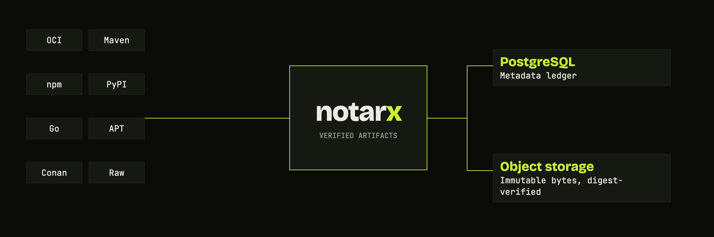
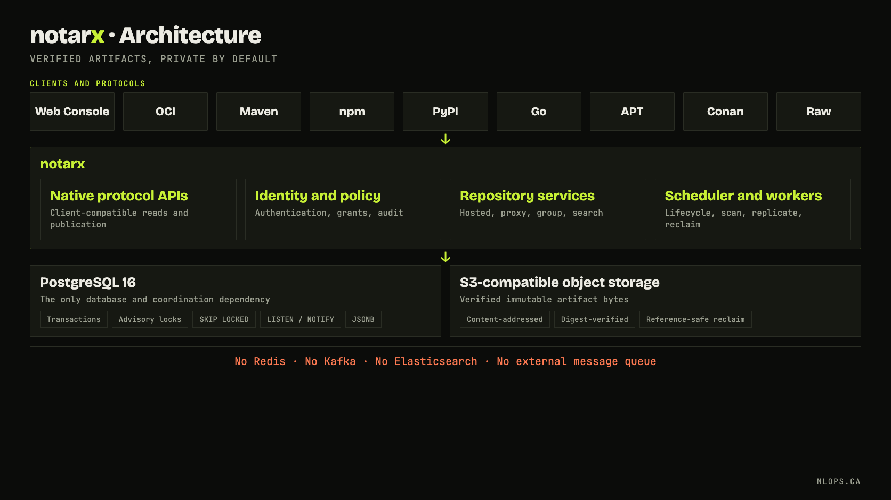

<p align="center">
  
</p>

<h1 align="center">notarx</h1>

<p align="center">
  Un dépôt léger et natif au protocole pour des artefacts logiciels vérifiés.
</p>

<p align="center">
  <a href="README.md">English</a> ·
  <a href="docs/README.fr-CA.md">Documentation</a> ·
  <a href="ARCHITECTURE.md">Architecture</a> ·
  <a href="CONTRIBUTING.fr-CA.md">Contribuer</a>
</p>

<p align="center">
  <a href="https://github.com/mlops-ca/notarx/actions/workflows/ci.yml"></a>
  <a href="https://github.com/mlops-ca/notarx/releases/tag/v0.4.1"></a>
  <a href="LICENSE"></a>
  
  
  
  
</p>

> [!IMPORTANT]
> **État du projet : version préliminaire.** La version 0.1.0 est la première
> distribution empaquetée. Elle convient à l’évaluation et à des travaux de
> migration encadrés, mais les contrats antérieurs à la version 1.0 peuvent
> encore évoluer et elle n’implique aucun engagement de soutien en production.

*Les guides techniques liés ci-dessous sont rédigés en anglais, sauf indication
contraire. Le noyau de la documentation (ce fichier, l’index de la documentation,
le guide de démarrage, la politique de sécurité et le guide de contribution) est
offert en français.*

## Pourquoi notarx

notarx garde volontairement le plan de contrôle opérationnel très
compact :

- **Un seul binaire Gateway.** La même image peut fonctionner comme nœud autonome
  compact ou se diviser en rôles d’API, d’ordonnanceur (scheduler) et de worker.
- **PostgreSQL est la seule dépendance de coordination et de base de données.**
  L’état des dépôts, l’autorisation, les tâches de cycle de vie, les baux, les
  verrous, l’idempotence, l’audit et la coordination opérationnelle passent tous
  par PostgreSQL.
- **Ni Redis, ni Kafka, ni Elasticsearch, ni file de messages externe ne sont
  nécessaires.**
- **Une empreinte Go mesurée.** La base de référence locale actuelle sous Docker
  a produit un binaire Gateway Linux/arm64 de 28,88 Mio et une image d’exécution
  de 36,06 Mio. Gateway a utilisé en moyenne 53,59 Mio au repos et a culminé
  près de 104 Mio en servant 128 clients simultanés; consultez la
  [base de référence de performance](docs/performance-baseline.md) pour le débit,
  la mémoire de la pile complète, la méthodologie et les limites.
- **Les octets des artefacts restent hors de la base de données.** Les octets
  immuables vérifiés passent par une interface de stockage d’objets compatible
  S3; la pile locale embarque RustFS.
- **Les protocoles natifs restent de première classe.** Les clients utilisent les
  routes habituelles des registres et des gestionnaires de paquets plutôt qu’un
  navigateur d’objets générique qui ne sait que téléverser.

En bref : PostgreSQL détient le plan de contrôle, le stockage compatible S3
détient le plan des octets, et Gateway relie les deux sans ajouter une flotte
d’intergiciels.

## Capacités des dépôts

| Format | Hébergé | Mandataire | Groupe | Notes |
| --- | :---: | :---: | :---: | --- |
| OCI | ✓ | ✓ | ✓ | Téléversements, manifestes, étiquettes, plages d’octets et référents du registre V2 |
| Raw | ✓ | ✓ | ✓ | PUT/GET/HEAD, plages d’octets, sommes de contrôle et téléversement reprenable |
| Maven | ✓ | ✓ | ✓ | Publication Maven/Gradle standard par défaut; l'[engagement strict par coordonnée](docs/maven-hosted-publication.md) est facultatif |
| Conan 2 | ✓ | ✓ | ✓ | Publication et cycle de vie sensibles aux révisions |
| npm | ✓ | ✓ | ✓ | Publication native, cache vérifié, packuments fusionnés |
| PyPI | ✓ | ✓ | ✓ | Téléversement natif avec twine et lectures PEP 503/691 |
| Modules Go | ✓ | ✓ | ✓ | Lectures GOPROXY standard; publication explicite de l’archive ZIP module/version |
| Cargo | ✓ | ✓ | ✓ | Registre sparse; publication et retrait (yank) hébergés, cache mandataire vérifié, propriété ordonnée des groupes; [configuration du client](docs/cargo-usage.md) |
| APT | Aperçu seulement | ✓ | ✓ | La signature hébergée reste non annoncée tant que les barrières de garde en production ne sont pas franchies |

NuGet offre des aperçus désactivés par défaut, [hébergé](docs/nuget-hosted-preview.md)
et [mandataire/groupe](docs/nuget-proxy-group-preview.md); l’admission formelle du
format reste suivie sous #289. Son [aperçu de réplication hébergée durable](docs/nuget-replication-preview.md)
copie les paquets vérifiés dans un stockage appartenant à la cible. L'[aperçu HTTP
de Helm](docs/helm-hosted-preview.md), désactivé par défaut, couvre les lectures
hébergées, mandataires et de groupe avec une gouvernance versionnée, tandis que
[RubyGems hébergé](docs/rubygems-hosted-preview.md) ajoute la publication native
et les index de dépendances. Ces aperçus demeurent hors des formats admis du
tableau; l’admission complète de Helm et de RubyGems reste suivie sous #292 et
#293. OCI prend en charge la
[découverte du catalogue et des référents](docs/oci-discovery.md) autorisée, avec
une couverture explicite de l’amont et des fermetures de contenu vérifiées.
L’énoncé détaillé, lié aux tests, se trouve dans la
[base de référence de compatibilité des protocoles](docs/protocol-compatibility.md).

Maven hébergé utilise par défaut la publication directe standard : les commandes
habituelles `mvn deploy` et `publish` de Gradle ne demandent donc aucune étape
complémentaire. Un dépôt peut opter pour la publication stricte lorsque la
visibilité atomique par coordonnée justifie une intégration d’engagement
supplémentaire avec Gateway.

Les clients utilisent les [racines de protocole canoniques](docs/protocol-compatibility.md#native-client-roots) :
Maven hébergé sous `/repository/maven/<dépôt>/`, Maven mandataire et groupe sous
`/maven/<dépôt>/`, npm sous `/npm/<dépôt>/`, PyPI sous `/pypi/<dépôt>/`
(téléversement sous `legacy/`, lectures sous `simple/`), Raw sous
`/raw/<dépôt>/` et Go sous `/go/<dépôt>/`. La publication Go exige le chemin
explicite de l’archive ZIP module/version. OCI utilise `/v2/`. Les anciens alias
Nexus `/repository/<nom>/...` retournent 404; mettez à jour les URL des clients
et régénérez les fichiers de verrouillage qui conservent les anciennes racines.

Au-delà des lectures et des écritures de protocole, la base actuelle comprend les
autorisations par dépôt, les utilisateurs locaux et OIDC, les comptes de service,
la visibilité des dépôts et la barrière d’accès public, l’audit, la recherche et
la navigation, la conservation, la suppression récupérable, la promotion, la
réplication, les webhooks, l’intégration de l’analyseur, la quarantaine, les
diagnostics, les métriques ainsi que les procédures de sauvegarde et de
restauration. Chaque domaine est suivi à partir de l'[index de la documentation](docs/README.fr-CA.md).

## Installer la version 0.4.1

La [version 0.4.1](https://github.com/mlops-ca/notarx/releases/tag/v0.4.1)
contient des archives Linux et macOS pour amd64 et arm64, le paquet statique de la
Console, les contrats OpenAPI résolus et `SHA256SUMS`. Chaque archive Gateway
comprend les binaires du serveur et de la vérification d’état, les migrations
PostgreSQL, un exécuteur de migrations portable et un modèle d’environnement.
Vérifiez l’identité avec :

```sh
./notarx version
```

Pour une installation à partir des binaires, installez `psql`, configurez
PostgreSQL et un stockage d’objets compatible S3, puis appliquez les migrations
fournies avant de démarrer Gateway :

```sh
MIGRATION_DIR=./migrations ./run-migrations.sh
```

Les images de conteneur sont publiées dans GHCR, pour la version stable comme pour
le développement :

```text
ghcr.io/mlops-ca/notarx:0.4.1
ghcr.io/mlops-ca/notarx-console:0.4.1
ghcr.io/mlops-ca/notarx:main
ghcr.io/mlops-ca/notarx-console:main
```

`main` est un instantané de développement mobile, qualifié par l’intégration
continue. Les déploiements de production devraient épingler `0.4.1` ou le
condensé (digest) d’image indiqué. La visibilité des paquets suit celle du dépôt
GitHub et du paquet GHCR.

## Démarrage local rapide

Prérequis : Docker avec Compose, Node.js 24 ou plus, npm, GNU Make et OpenSSL.

```sh
git clone https://github.com/mlops-ca/notarx.git
cd artifact-gateway
make dev-bootstrap
make dev
```

`make dev-bootstrap` crée un fichier `.env` privé au besoin et génère seulement
les six justificatifs requis par la pile locale Gateway, PostgreSQL et RustFS. Il
n’affiche aucun secret, n’écrase aucune vraie valeur et ne crée pas de nouvelle
copie de retour arrière lorsqu’aucun changement n’est nécessaire.

`make dev` construit et démarre Gateway, PostgreSQL et RustFS, installe les
dépendances épinglées de la Console si elles sont absentes, puis attend que l’API
et la Console répondent.

Ouvrez la Console à l’adresse <http://127.0.0.1:4173>. Connectez-vous avec le
`NOTARX_ADMIN_TOKEN` stocké dans `.env`, puis créez un dépôt hébergé,
mandataire ou de groupe depuis la page Dépôts.

```sh
make dev-status   # Console, mandataire, vivacité et disponibilité
make dev-down     # arrête seulement la Console gérée par le dépôt local
make down         # arrête les services Compose et conserve les volumes de données
```

`make cli-build` compile en croisé `notarxctl`, le client en ligne de commande
pour les pipelines d’intégration continue et l’administration de la plateforme,
vers `dist/notarxctl_<goos>_<goarch>` pour Linux et macOS, et
`make cli-docker-build` construit l’image de conteneur du client. Consultez le
guide de la [CLI notarxctl](docs/cli.md) pour les canaux d’installation et leurs
limites actuelles.

Consultez le [guide de démarrage](docs/getting-started.fr-CA.md) pour la gestion
des justificatifs, les consignes pour le premier dépôt, les ports, les commandes
de cycle de vie et le dépannage.

## L’architecture en un coup d’œil



Le rôle `standalone` par défaut exécute les responsabilités d’API,
d’ordonnanceur et de worker dans un seul processus. Les grandes installations
peuvent diviser la même image par rôle sans introduire de file d’attente distincte
ni de dépendance de découverte de services. Consultez
[Architecture](ARCHITECTURE.md), les [diagrammes d’architecture](docs/architecture-diagrams.md)
et les [capacités PostgreSQL](docs/postgresql-capabilities.md).

## Carte de la documentation

| Besoin | Point de départ |
| --- | --- |
| Configurer une copie de travail locale | [Guide de démarrage](docs/getting-started.fr-CA.md) |
| Comprendre le comportement des protocoles | [Compatibilité des protocoles](docs/protocol-compatibility.md) |
| Publier des coordonnées Maven hébergées | [Publication Maven hébergée](docs/maven-hosted-publication.md) |
| Comprendre les frontières du noyau | [Architecture](ARCHITECTURE.md) |
| Explorer les flux du système et de publication | [Diagrammes d’architecture](docs/architecture-diagrams.md) |
| Comprendre la coordination PostgreSQL | [Capacités PostgreSQL](docs/postgresql-capabilities.md) |
| Examiner la taille, la mémoire et la concurrence locale | [Base de référence de performance](docs/performance-baseline.md) |
| Examiner la qualité d’ingénierie actuelle | [Évaluation de la qualité du projet](docs/project-quality-assessment.md) |
| Exploiter l’identité et les accès | [Gouvernance des utilisateurs](docs/user-governance.md), [SSO OIDC](docs/oidc-sso.md), [Comptes de service](docs/service-account-operations.md) |
| Déployer ou rétablir | [Kubernetes](docs/kubernetes-deployment.md), [Déploiement distribué](docs/distributed-deployment.md), [Guide de reprise](docs/recovery-runbook.md) |
| Étendre un format de paquets | [Guide d’extension des formats](docs/format-extension-guide.md) |
| Modifier l’API de gestion | [Gouvernance OpenAPI](docs/openapi-governance-plan.md) |
| Parcourir tous les guides maintenus | [Index de la documentation](docs/README.fr-CA.md) |

## Flux de développement

```sh
make test
make lint
make vet
make coverage
make build
```

Les changements de protocole, de persistance, de Console et de déploiement
ajoutent des barrières ciblées. Les clients OpenAPI et les contrats de serveur
générés ne doivent pas être modifiés à la main. Lisez
[CONTRIBUTING.fr-CA.md](CONTRIBUTING.fr-CA.md) avant de modifier le code et
consignez le comportement visible pour l’utilisateur dans le titre de la demande
de tirage (pull request); [CHANGELOG.md](CHANGELOG.md) en est généré au moment de
la publication.

Les nouveaux écosystèmes de paquets doivent satisfaire aux règles d’admission du
[guide d’extension des formats](docs/format-extension-guide.md). Ajouter
seulement une énumération, un paramètre de route ou une option de Console ne
compte pas comme une prise en charge du protocole.

## Licence

notarx est offert sous la [licence MIT](LICENSE). Les composants et
les ressources tiers restent soumis à leurs propres conditions de licence. Le nom
et le logo sont couverts par la [politique sur les marques de commerce](TRADEMARKS.md).
