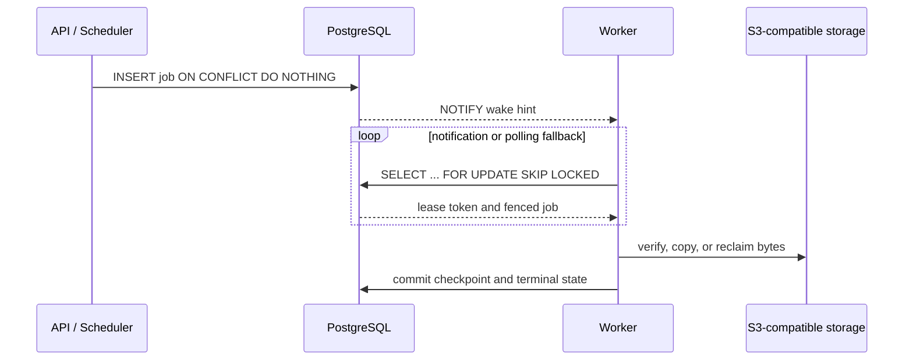

# PostgreSQL capabilities and operational boundaries

[简体中文](postgresql-capabilities.zh-CN.md) · [Architecture diagrams](architecture-diagrams.md) · [Documentation index](README.md)

The runtime baseline is PostgreSQL 16 or later; the reference image runs PostgreSQL 18. notarx uses PostgreSQL as its
only database and control-plane coordination service. Repositories,
authorization, artifact metadata, audit records, idempotency keys, background
jobs, leases, locks, and runtime-node state all treat PostgreSQL as the source
of truth.

“Lightweight” does not mean PostgreSQL is the only storage system. Verified
immutable artifact bytes remain in an object store: S3-compatible object storage
(the local stack bundles RustFS) or, on a single node, the filesystem driver; see
[object storage configuration](object-storage.md). Redis, Kafka, Elasticsearch,
and a separate message queue are not required.

## PostgreSQL-native or PostgreSQL-bound capabilities

Some entries below are PostgreSQL-specific; others exist in additional
databases, but notarx relies on their PostgreSQL syntax and failure
semantics.

| Capability | Use in notarx | Why it matters |
| --- | --- | --- |
| Session and transaction advisory locks | OCI/Raw uploads, object deduplication, cache fills, first Maven/npm publication, user administration, lifecycle serialization | Logical resources do not need a dedicated lock table; locks release with the connection or transaction |
| `hashtextextended` lock keys | Maps repository names, object keys, upload IDs, and package coordinates into one stable 64-bit lock space | Every Gateway instance derives the same lock for the same logical resource |
| `FOR UPDATE SKIP LOCKED` | Claims lifecycle, replication, cache, webhook, audit, upload-expiry, session-cleanup, and scheduled work | Workers claim different rows concurrently without a separate queue or lock convoy |
| `LISTEN/NOTIFY` | Wakes lifecycle (one channel per job kind, `notarx_jobs_<kind>`), webhook delivery (`notarx_deliveries`), replication, cache, audit-cleanup, and repository-deletion workers | Reduces polling latency while durable tables and leases remain authoritative |
| PL/pgSQL triggers | Emits `pg_notify` when work becomes runnable and enforces selected capacity boundaries | State changes and wake hints share the database transaction boundary |
| `ON CONFLICT`, unique constraints, and `RETURNING` | Idempotent publication, task deduplication, object references, node heartbeats, singleton settings, and tag movement | Existence checks, writes, and state readback remain one concurrency-safe statement |
| JSONB and JSONB operators | npm manifests/tags, OIDC roles, scanner intelligence, webhook payloads, dynamic policy, runtime roles | Keeps relational identity while representing format-specific data with JSON type checks |
| `pg_trgm` and partial GIN indexes | Literal contains search of coordinates, package names and paths | Selective fragments can use GIN; short/common fragments can still scan many rows |
| `text_pattern_ops` B-tree indexes | Literal prefix paging across Maven, OCI, Raw, Conan, npm, PyPI, Go, and APT | Preserves indexed `LIKE 'prefix%'` behaviour outside the `C` locale |
| BRIN indexes | Audit, lifecycle, replication-checkpoint, OCI, and Conan timelines | Keeps append-heavy time indexes compact |
| `DISTINCT ON`, `LATERAL`, and views | Builds the format-neutral `artifact_search_projection` and selects latest visible records | Performs format projection and version folding in PostgreSQL while authorization remains in the application |
| `pg_stat_statements` | Observes query calls, total/mean execution time, and returned rows | Tunes from real workload evidence rather than static guesses |
| `gen_random_uuid`, `TIMESTAMPTZ`, intervals | Lease tokens, schedule run IDs, expiry, and retry timing | Creates fencing identity and database-consistent time inside claim statements |

## How far the code is bound to PostgreSQL

PostgreSQL 16 or later is the reference database and the only one supported in
v0.1.0 (ADR 0017). The binding goes well beyond SQL syntax, and there is no
dialect layer: the `*Store` interfaces in `internal/repository/store.go` are a
seam, but every implementation is raw PostgreSQL SQL. Counts from the tree on
2026-11-18, by `grep` over non-test Go files under `internal/` and over
`migrations/` (indicative, not a guarantee):

| Dependency | Count |
| --- | --- |
| Advisory-lock calls (`pg_advisory_*`, `pg_try_advisory_*`) | about 41 lines in 26 files, wrapped by `internal/repository/postgres_advisory_lock.go` and used by `internal/cache/coordinator.go` |
| `FOR UPDATE SKIP LOCKED` work-queue claims | about 27 sites in 21 files |
| `LISTEN` and `pg_notify` | listener in `internal/database/notification.go`, `pg_notify` in `internal/app/postgres_cache_task_queue.go`, notify triggers in `migrations/000001_baseline.sql` |
| `CREATE TRIGGER` statements | 10 in `migrations/000001_baseline.sql` |
| `gin_trgm_ops` (`pg_trgm`) indexes | 13 in the baseline |
| `ON CONFLICT` / `RETURNING` | about 113 / 146 |
| `::` casts | about 1,400 |
| `DISTINCT ON` / `ILIKE` | 3 / 6 |
| `pg_stat_statements` | preloaded by the Compose files and the isolated backup target; no Go code reads it |

Migrations are a single baseline plus numbered migrations (ADR 0015), applied by
`scripts/run-migrations.sh`. The baseline generator and the equivalence proof
(`scripts/baseline-lib.sh`) pin `postgres:18-alpine` by digest; the dump normalizer is
tested against a PostgreSQL 16 and a PostgreSQL 18 `pg_dump`, and the equivalence
workflow also runs on the pinned 16 image while 16 remains supported.

### Criteria for revisiting the single-database decision

An ADR proposing a second database is accepted only when all of these hold:

1. there is a concrete, funded user population that cannot run PostgreSQL;
2. a dialect abstraction keeps advisory-lock, queue-claim and notify semantics
   provably equivalent, and the existing PostgreSQL integration suite is re-run
   against it;
3. a named maintainer owns the extra test matrix.

Without these, SQLite and Oracle requests are declined. ADR 0022 meets them for
MySQL only (the funded population is the Oracle Cloud free tier).

## Managed PostgreSQL support matrix

A managed PostgreSQL service is supported through `NOTARX_DATABASE_URL` when it
meets every row. Providers that cannot meet every row are unsupported.

| Requirement | Why | Failure mode |
| --- | --- | --- |
| PostgreSQL 16 or later | tested on 18 (Compose, Kubernetes, backup-ops and the schema baseline generator) and 16 (baseline equivalence proof and dump normalizer fixture) | unsupported |
| `CREATE EXTENSION pg_trgm` allowed | GIN trigram indexes in the baseline | the baseline fails; unsupported |
| `pg_stat_statements` (optional) | created in a guarded block by the baseline (ADR 0015); no Go code reads it | statement statistics unavailable; the migration still succeeds |
| Session-level connections (direct, or a pooler in session mode) | session advisory locks and `LISTEN/NOTIFY` | locks and notifications are lost behind a transaction-mode pooler; unsupported |
| Row triggers and PL/pgSQL | 23 triggers, including capacity enforcement | unsupported |
| The role may `CREATE` in the target schema | the migration runner | unsupported |

### Verified providers

No managed provider is listed as supported until it has been tested against every
row of the matrix and the result is recorded here, with the provider, the
PostgreSQL version, the date, who ran it and the outcome per row.

| Provider | PostgreSQL | Date | Verified by | Result |
| --- | --- | --- | --- | --- |
| none recorded | | | | |

Self-hosted `postgres:18-alpine` (multi-arch, including arm64) is the reference
and what the Compose stack and the Oracle Cloud reference deployment run. Cloud
claims, for example for Amazon RDS or Oracle Cloud Database with PostgreSQL, stay
out of this page until a row above is filled in.

## Coordination model



- Losing a notification does not lose work; workers continue polling durable
  task tables.
- `SKIP LOCKED` gives non-blocking claims. Lease tokens and expiry provide
  cross-process recovery and stale-worker fencing.
- Session advisory locks are tied to dedicated connections; transaction locks
  release on commit or rollback.
- PostgreSQL transactions decide metadata visibility. Bytes may be staged in
  object storage first; object intents and reclaim work recover unreferenced
  bytes after a transaction failure.

## Search and index composition

1. Literal prefixes use `text_pattern_ops` B-tree indexes and ordered cursors.
2. `match=contains` uses escaped `ILIKE '%keyword%'` and base-table `pg_trgm` GIN indexes. `%`, `_` and backslash are literal input, not wildcards.
3. Partial indexes exclude states that are not protocol-visible.
4. Append-heavy timelines use BRIN instead of ever-growing B-tree indexes.
5. `artifact_search_projection` uses `UNION ALL`, `DISTINCT ON`, and `LATERAL`
   to normalize format metadata; application code still authorizes results.
6. SHA-256 lookup uses repository-and-digest composite indexes, not fuzzy search.

The main global and repository artifact-search endpoints accept optional
`match=prefix|contains`. Omission preserves the old per-format behaviour (Cargo
name substring; other formats literal prefix). Contains is case insensitive;
explicit Prefix is case sensitive. Existing signed tokens without a mode remain
valid with omitted `match`; a token cannot be reused with a changed query, mode,
format or repository. Complete global SHA-256 queries retain exact digest
semantics and the existing supported-format boundary.

Console global search, ordinary repository lists and selected public-repository
search default to Contains. Public results load the next cursor on demand.
Maven Proxy's management list still searches known cache metadata; it does not
discover the upstream inventory. Conan's management list still has its separate
current-page filter limitation; global and direct API Conan search use the new
mode. Directory navigation, identity selectors and resource-prefix authorization
keep their existing contracts.

Search fields are Maven GAV, OCI name, Conan reference, npm/PyPI/Cargo package
name, Go module path and Raw/APT canonical path. For example `alpha` finds
`org.example:alpha:1.0`, `team/alpha` and `releases/alpha.bin`. Maven asset file
names, README text, publisher and binary contents are not indexed. Raw searches
canonicalize readable input without changing the identity used by an exact deep
link or artifact operation. Contains is neither spelling correction nor natural
language full-text search: `tsvector` matches lexemes, not arbitrary substrings.

One/two-character, punctuation-only and common fragments are accepted without
silently falling back to Prefix. A Contains request has a **five-second shared
budget**, including metadata/authorization reads and later repository probes;
incoming cancellation propagates to SQL. Timeout returns a failed request;
add a longer keyword or choose Prefix. Page sizes stay 1–200 (default 50).
Coordinate/build/digest keyset order and visible-state/version folding remain.
Each page rechecks authorization; pagination is not a persistent inventory
snapshot and has no total count. Inserts before a cursor are absent from later
pages; deletions may reduce a page; revocation prevents further reads.

The ordinary projection view cannot own a persistent GIN index. Migration 145
adds indexes to the remaining native search tables and reuses migration 64's
Maven/OCI/Conan/Raw indexes. Index build time, disk and write amplification need
capacity planning; the migration runner does not use `CREATE INDEX CONCURRENTLY`.
Do not infer production latency or index usage from index existence. The real
PostgreSQL regression `TestPostgresContainsSearchPlansAndCancellation` captures
pgx's actual complete prepared SQL and runs `EXPLAIN (ANALYZE, BUFFERS, VERBOSE)`
against fixed synthetic Raw inventory and Maven build history. Set
`NOTARX_SEARCH_PLAN_OUTPUT` to save every JSON plan; it never forces an index.
The companion HTTP probe-budget test includes global lookahead across three
readable repositories. [Measured fixture report](reports/artifact-contains-search-2026-10-12.md).

## Operational queries

```sql
SELECT calls, total_exec_time, mean_exec_time, rows, query
FROM pg_stat_statements
WHERE dbid = (SELECT oid FROM pg_database WHERE datname = current_database())
ORDER BY total_exec_time DESC
LIMIT 20;
```

```sql
EXPLAIN (ANALYZE, BUFFERS)
SELECT coordinate
FROM artifact_search_projection
WHERE repository_id = '<repository-id>'
  AND format = 'maven'
  AND coordinate LIKE 'org.example:%'
ORDER BY coordinate, build_number
LIMIT 50;
```

```sql
SELECT pid, wait_event_type, wait_event, state, query
FROM pg_stat_activity
WHERE datname = current_database()
  AND wait_event_type IS NOT NULL
ORDER BY backend_start;
```

## Partitioned audit tables

`resolver_audit_log` (async-class audit: reads, downloads, group resolution) and
`security_audit_log` (sync-class audit: security decisions and state changes) are
native range-partitioned tables, monthly by `occurred_at`, with the primary key
`(occurred_at, id)` and no foreign key pointing into them (ADR 0023 section 2).
Each has a `DEFAULT` partition, three indexes (the primary key,
`(repository, occurred_at DESC)` and `(actor, occurred_at DESC)`) and a nullable
`repository_id` beside the historical repository name. The default retention is
90 days for `resolver_audit_log` and 730 days for `security_audit_log`.

`internal/partitions` keeps them current without `pg_partman` or `pg_cron`:

- At start-up, before the node reports ready, and then every six hours it creates
  the current partition plus `NOTARX_PARTITION_AHEAD` (default 3) future ones with
  `CREATE TABLE IF NOT EXISTS ... PARTITION OF`, and drops partitions whose whole
  range is older than the table's retention with `SET LOCAL lock_timeout='2s'; DROP
  TABLE`, retried with backoff. `DETACH PARTITION ... CONCURRENTLY` is not used: it
  cannot run in a transaction block and is refused while a `DEFAULT` partition
  exists.
- An enabled audit retention policy (`keepDays`) overrides the 90 days of
  `resolver_audit_log`; `security_audit_log` keeps its registry default.
  Every node refreshes the two gauges each minute, and a failed pass is retried
  after a minute.
- One node at a time runs the work. The runner is elected by a lease row in
  `scheduled_tasks` (kind `partition-manager`, never enabled, hidden from the task
  API); no session advisory lock is held, so it works behind a connection pool in transaction mode.
- A period whose range already has rows in the `DEFAULT` partition cannot be
  created directly. The manager creates the partition standalone, moves the rows
  with `DELETE ... RETURNING` into it and attaches it in one transaction.
- `notarx_partition_default_rows{table}` must be 0; a non-zero value means the
  manager is not keeping up and should alert. `notarx_partitions{table}` is the
  number of bounded partitions.

The audit list API (`GET /api/v2/audits/page`) returns one keyset page merged
across both tables by `(occurred_at, id)` and accepts `class=sync|async` to read
one table. Without `from` it searches the table's default retention window, so the
planner can prune partitions; pass `from` and `to` to bound large scans.

Writes are decoupled from the request path by `internal/auditwriter`: sync-class
records are committed immediately (statement per record), async-class records are
flushed in batches with one `INSERT ... SELECT FROM unnest(...)` per table. Usage
aggregates (`artifact_usage_stats`, keyed by `repository_id`) and the hourly
`repository_request_rollup(repository_id, bucket_start, outcome, requests, bytes)`
are added in key order with `INSERT ... ON CONFLICT DO UPDATE`, so two nodes flushing
the same keys take their row locks in the same order. See
[distributed deployment](distributed-deployment.md#audit-durability-and-capacity) for
the guarantees and the settings.

MySQL (ADR 0022) uses plain tables with an `AUTO_INCREMENT` key and batched
retention; that twin is written with the ADR 0022 store slices.

## Explicitly not used

- **RLS:** tables do not yet share a tenant ID or consistent session tenant
  context across workers and administrator flows.
- **Table partitioning:** current audit/job volume has not justified monthly
  range partitions.
- **Logical replication as a task bus:** durable tables, leases, and polling
  recover work without WAL/CDC consumers.
- **Large objects or `bytea` artifacts:** object storage owns content-addressed
  bytes; PostgreSQL stores digests, references, object intents, and lifecycle
  state.

## Code evidence

| Area | Primary implementation |
| --- | --- |
| Partitioned audit tables | `internal/partitions`, partitioned `audit_logs` in `migrations/000001_baseline.sql`, `internal/repository/postgres_audit.go` |
| Advisory locks | `internal/cache/coordinator.go`, `internal/repository/postgres_advisory_lock.go`, `postgres_{oci,raw,maven,npm}.go` |
| `SKIP LOCKED` and leases | `internal/repository/postgres_lifecycle.go`, `postgres_replication.go`, `postgres_webhooks.go`, `postgres_scheduled_tasks.go` |
| `LISTEN/NOTIFY` | `internal/database/notification.go`, notification triggers in `migrations/000001_baseline.sql` |
| Extensions and indexes | extension header and trigram, BRIN and prefix-pattern indexes in `migrations/000001_baseline.sql` |
| Cross-format search | `artifact_search_projection` view in `migrations/000001_baseline.sql` |
| Capacity serialization | `repository_usage_counters` and its functions in `migrations/000001_baseline.sql` |

`scripts/run-migrations.sh` applies migrations in checksum order. Changes to
startup settings such as `shared_preload_libraries` require a PostgreSQL restart
or container rebuild, never deletion of the `notarx-postgres` data volume.

### Upgrading an existing Compose stack from PostgreSQL 16 to 18

PostgreSQL 18 images store the cluster under `/var/lib/postgresql/18/docker` and
the Compose volume is mounted at `/var/lib/postgresql`. A `notarx-postgres`
volume created by the 16 image keeps its cluster in `data/`, which the 18 image
ignores, so the stack would start with an empty database. Before pulling this
change, dump with the old stack (`docker compose exec -T postgres pg_dump -U
notarx -d notarx --format=custom > notarx.dump`), run `docker compose down
--volumes`, start the new stack, and restore with `pg_restore` (or recreate the
stack from a verified backup). The volume is never reused across majors in place.
